# Delta ODB++

A Java library for parsing ODB++ PCB design archives, rendering them to SVG/PNG,
and converting them to Gerber X2 + Excellon. Ships with an interactive web viewer.

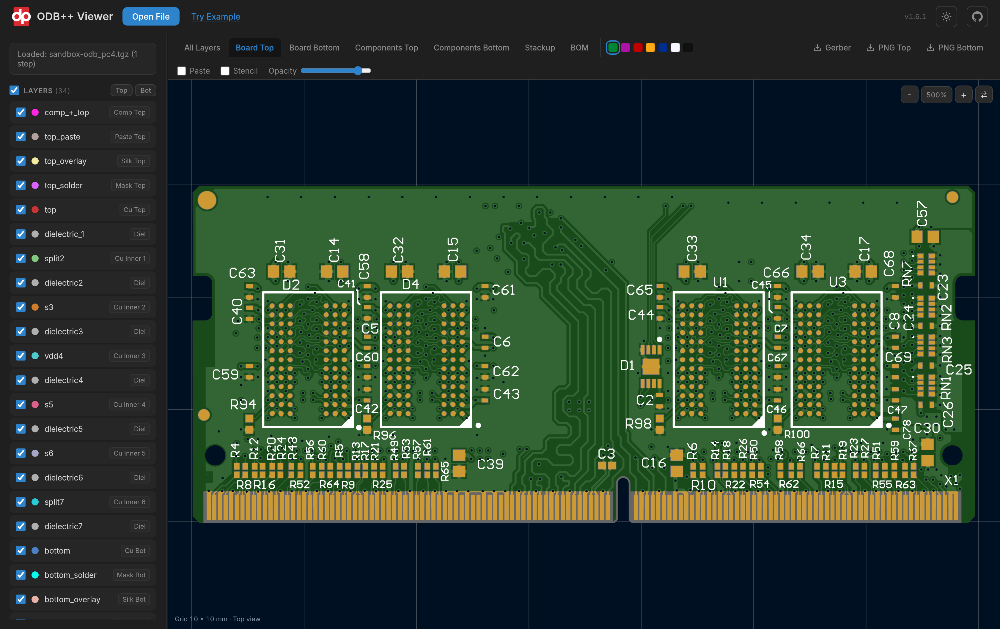

*The bundled web viewer showing the realistic top side of an 8-layer memory module —
copper, soldermask, silkscreen, gold fingers and drills, rendered straight from the
ODB++ archive.*

## The Viewer at a Glance

| | |
|---|---|
| 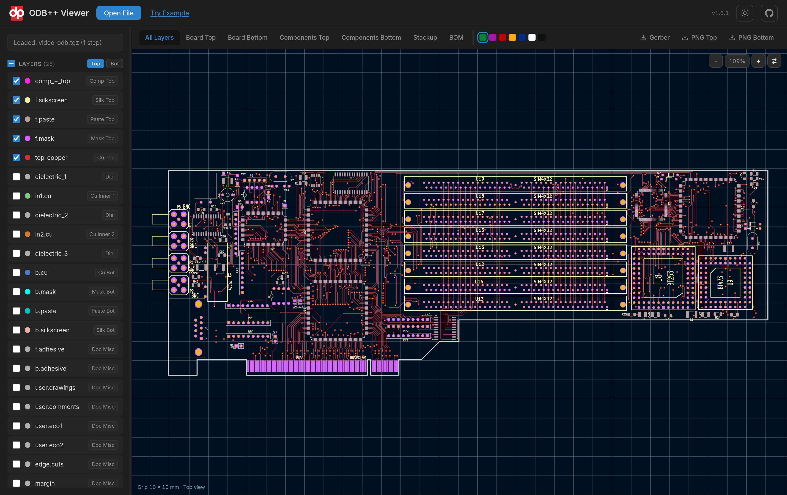 | 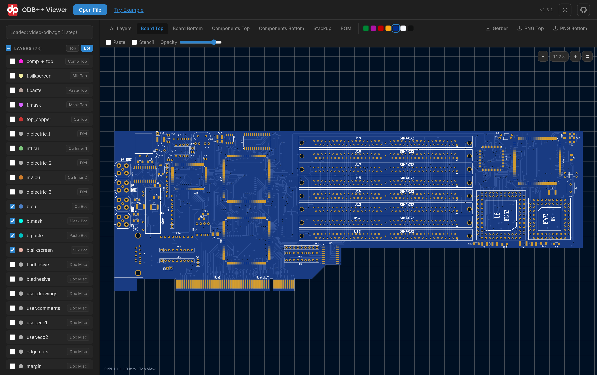 |
| **Layer view** — every matrix layer as its own toggleable SVG layer in KiCad's layer colours; *Top* / *Bot* pick one side of the board (the bottom is shown mirrored, as seen from below), hovering a layer isolates it | **Soldermask colours** — green, purple, red, yellow, blue, white or black, switched live in the realistic views |
| 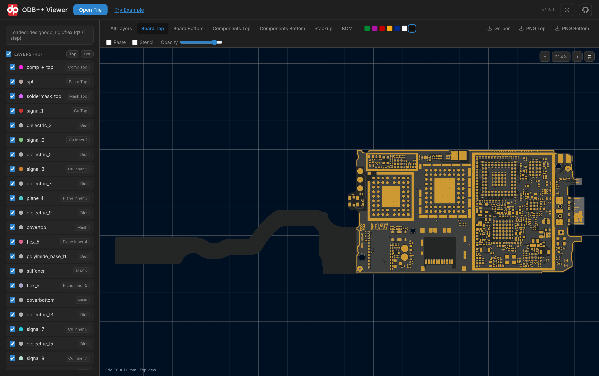 | 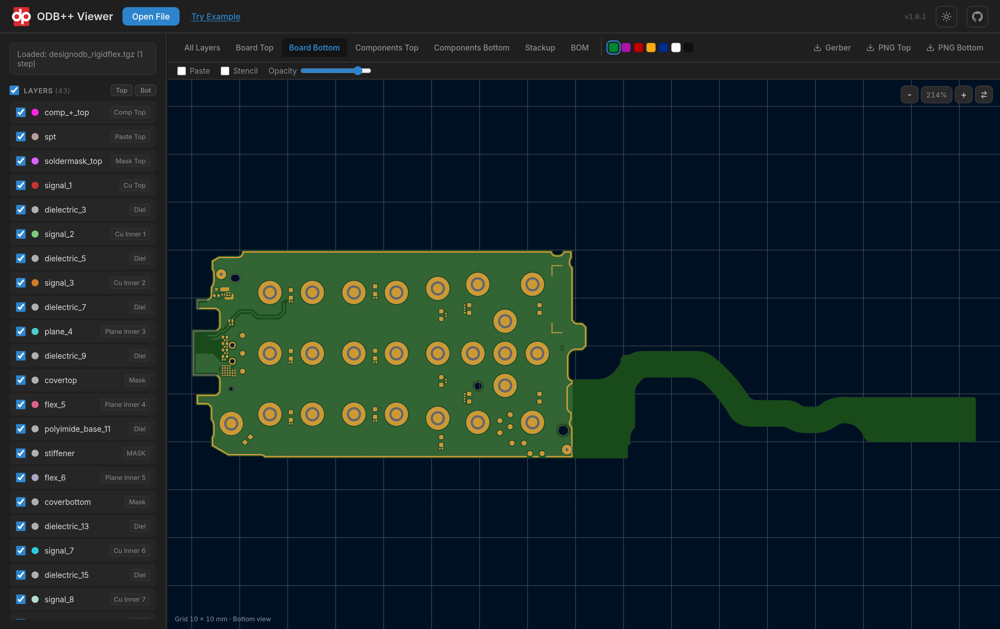 |
| **Rigid-flex** — flex tail, coverlay and the dense BGA fan-outs of a 10-layer rigid-flex design | **Both sides** — the bottom of the same board, viewed from below |
| 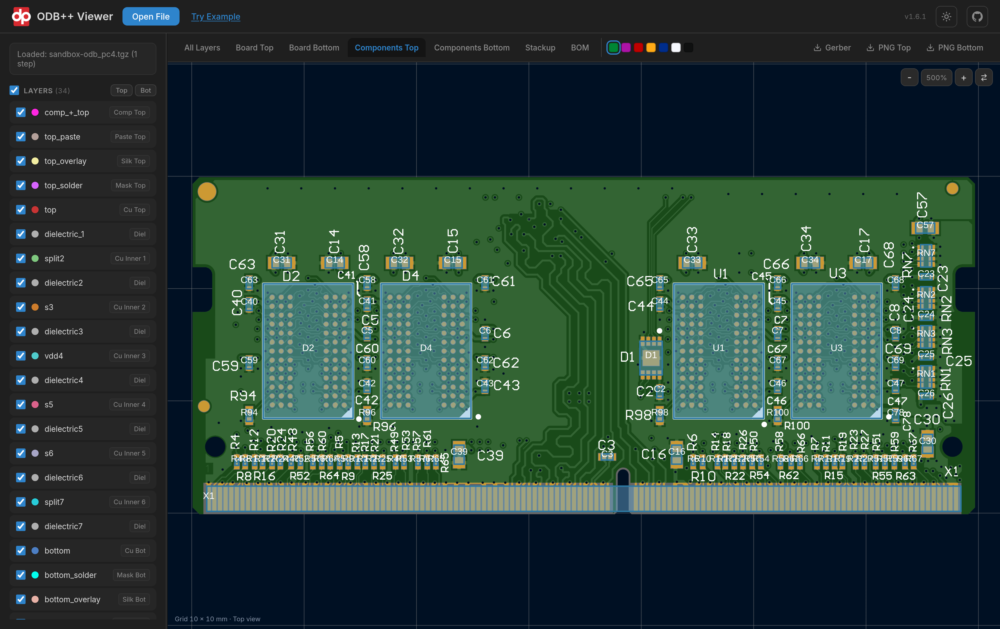 | 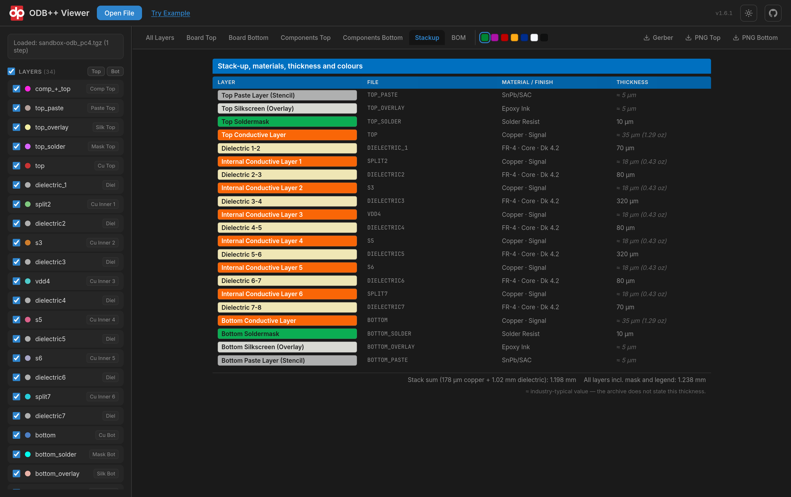 |
| **Components** — package outlines, pins and reference designators over the board, per side | **Stackup** — materials, dielectric constants and thicknesses, with the stack sum |
| 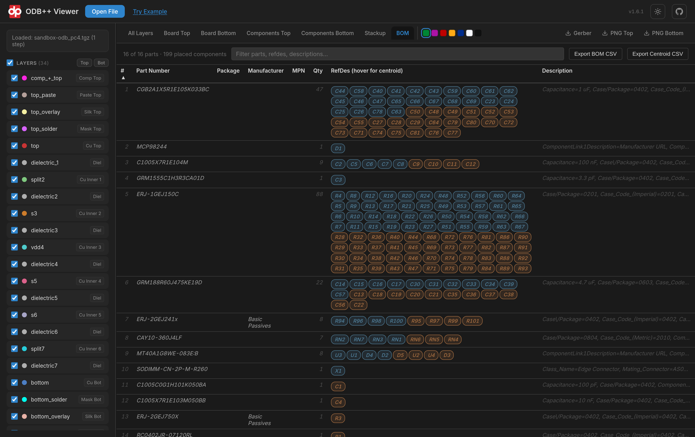 | 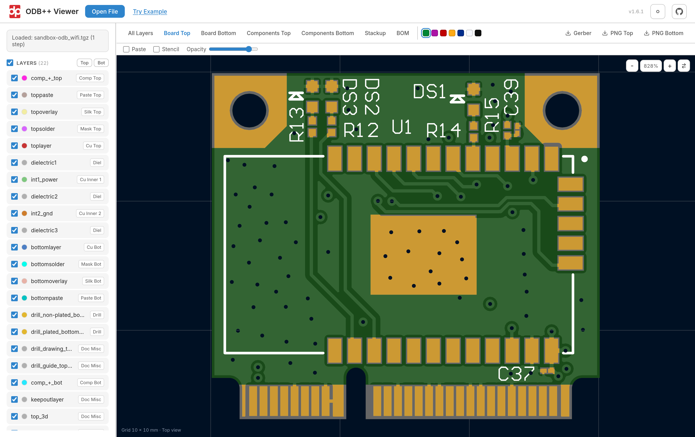 |
| **BOM** — parts grouped with their reference designators, searchable, exportable as BOM or centroid CSV | **Light and dark themes** — plus one-click Gerber and PNG downloads |
| 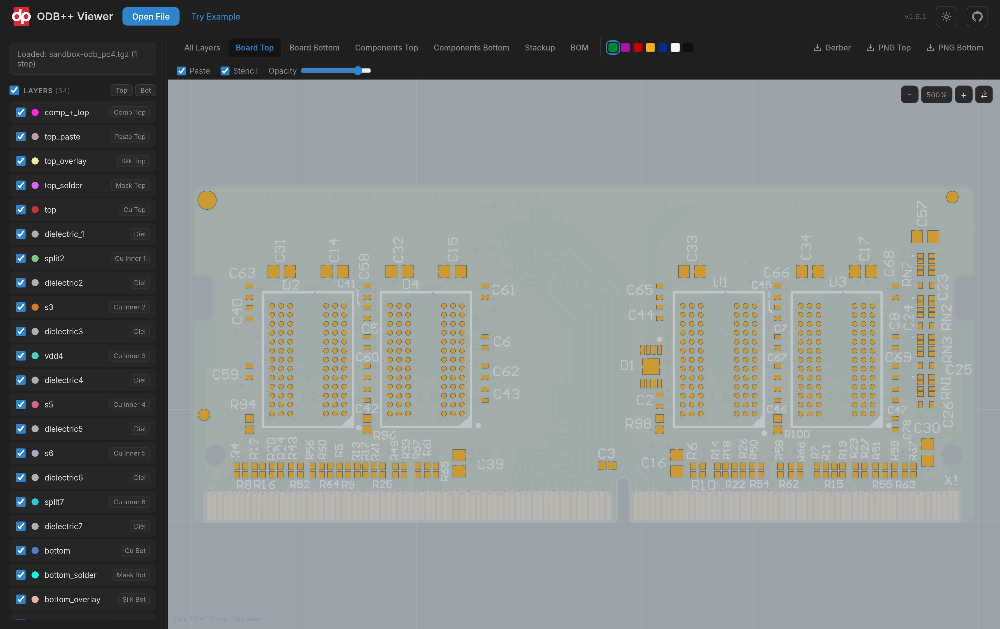 | 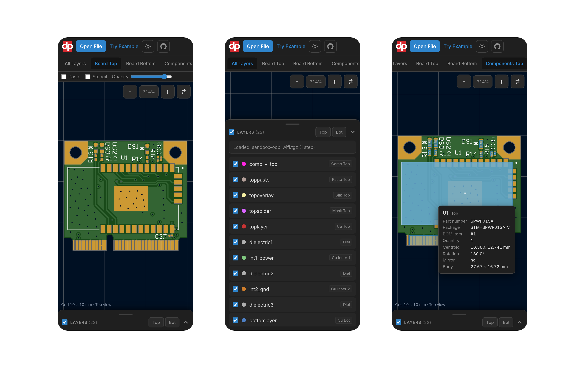 |
| **Paste and stencil** — solder paste on the pads, optionally seen through a stencil foil with its apertures cut out, with adjustable opacity | **On a phone** — the layer list becomes a bottom sheet, the tabs scroll sideways; drag to pan, pinch to zoom, tap a component for its details |

All screenshots show the openly-available sample archives in [`examples/`](examples).

## Maven Dependency

```xml
<dependency>
    <groupId>com.deltaproto</groupId>
    <artifactId>delta-odbpp</artifactId>
    <version>1.6.1</version>
</dependency>
```

## Features

### ODB++ Parsing
- Reads ODB++ archives (`.zip`, `.tgz`, `.tar.gz`) and exploded directories
- Full job model: matrix, steps, layers, and features
  (pad, line, arc, surface, text, barcode)
- Symbols (standard + user-defined), components, BOM, netlists, EDA data
- Stackup, impedance, profile, and attribute parsing
- The whole model is normalised to **millimetres at parse time**
- Malformed or partial archives degrade gracefully with recorded warnings

### SVG / PNG Rendering
- Per-layer SVG rendering with the full ODB++ standard-symbol catalogue: every
  symbol is drawn from its exact outline (thermals, donuts, rounded and chamfered
  rectangles, ovals, butterflies, moiré, hole symbols, …), user-defined symbols
  included, with rotation, mirroring and resize
- Multi-layer composite rendering with configurable colours and opacity;
  `LayerPalette.kicad(matrix)` colours a board the way KiCad does (copper by
  side, a distinct colour per inner layer, mask, silk, paste, drills, outline)
- Realistic top/bottom PCB views: copper under soldermask, exposed pads in the
  surface finish, silkscreen, through holes, and blind or micro vias as dimples
  under the mask; seven soldermask colours. The SVG also carries hidden
  solder-paste and stencil-foil groups a viewer can switch on
- Negative (clear) features cut through the layer instead of being painted in the
  background colour, so layers stay correct when stacked
- Frames are computed from what a layer actually draws — pad shapes, stroke
  widths and arc bulges — so nothing on the edge of the artwork is clipped
- Component silhouette and centroid views
- PCB layer-stackup cross-section view
- PNG rasterisation of any view through the Batik pipeline

### ODB++ → Gerber / Excellon Conversion
- Gerber X2 writer with `.FileFunction` / `.FilePolarity` attributes, regions
  (G36/G37), arcs (G75), and polarity (LPD/LPC)
- Surfaces with holes become single fractured (cut-in) region contours, so a
  plane's clearances never erase traces drawn underneath
- Aperture mapping to standard apertures and aperture macros (rounded and
  chamfered rectangles with per-corner selection, thermals, donuts), with full
  user-symbol flattening and transforms
- Excellon writer with drill hits, oval-pad and line **slots** (G85), tools
  numbered by ascending diameter, X2 attribute comments
- Matrix-driven layer mapping for copper, soldermask, paste, legend,
  plated/non-plated drills, and the board profile; files are named the way
  KiCad names its plots (`F_Cu.gtl`, `In1_Cu.g1`, `B_Mask.gbs`, `Edge_Cuts.gm1`,
  `PTH.drl`, …)
- Options: subtract soldermask openings from the legend, file-name prefix,
  outline stroke width (derived from the design's outline layer by default)
- Verified against the EDA tools' own Gerber plots: every layer of KiCad and
  Altium reference boards rasterises to the same image (see
  `GerberReferenceTest`)

### Web Viewer (`delta-odbpp-app`)
- Spring Boot app: open an archive (or press **Try Example**) and browse it in
  the browser — nothing is installed on the client
- **All Layers**: stacked SVG layers in KiCad's colours with per-layer toggling,
  *Top* / *Bot* side filters (a bottom-only selection is mirrored, as seen from
  below), hover-to-isolate, pan and zoom on a millimetre grid
- **Board Top / Board Bottom**: realistic renders with a live soldermask colour
  picker and a solder-paste / stencil overlay with adjustable opacity
- **Components Top / Bottom**: package outlines and reference designators over
  the board; hover or tap a component for its part, package and placement
- **Stackup**: layer table with materials, Dk and thicknesses
- **BOM**: searchable parts list with BOM and centroid CSV export
- Downloads: Gerber X2 + Excellon zip, PNG of either side
- Light and dark themes
- Works on a phone: the layer list is a swipe-up bottom sheet, the view tabs
  scroll sideways, one finger pans, two fingers pinch-zoom

## Quick Start

```bash
mvn clean install
cd odbpp-app
mvn spring-boot:run
```

Open http://localhost:8080 and upload an ODB++ archive.

## Usage as a Library

### Parse an archive

```java
// From an exploded ODB++ directory
Job job = new OdbParser().parse(Path.of("path/to/odb"));

// Or from a .zip / .tgz archive
Path root = new OdbArchiveExtractor().extractToTemp(Path.of("board.tgz"));
Job job2 = new OdbParser().parse(root);
```

### Render to SVG

```java
// One image with all layers stacked, top view
MultiLayerSvgRenderer.forTopView().renderJob(job, Path.of("top.svg"));

// Realistic top + bottom PNGs
byte[] topPng = new MultiLayerSvgRenderer().renderRealisticSidePng(job, true, 1024);
Files.write(Path.of("board-top.png"), topPng);
```

### Convert to Gerber + Excellon

```java
OdbToGerberConverter.Result result = new OdbToGerberConverter()
        .setSubtractSoldermaskFromLegend(true)   // optional, KiCad-style legend clipping
        .setFileNamePrefix("myboard-")           // optional
        .convert(job);                           // first step; or convert(job, "pcb")
result.writeTo(Path.of("gerber-out"));           // F_Cu.gtl, In1_Cu.g1, …, PTH.drl
result.writeZip(new FileOutputStream("gerber-out.zip")); // or result.toZip() for bytes
result.warnings.forEach(System.out::println);    // any conversion warnings
```

The web viewer exposes the same conversion as `POST /api/odbpp/gerber` (multipart
`file`, returns the zip) and as the **Gerber** download button.

## Symbol Visual Test

The library includes a visual catalogue of all implemented ODB++ symbol types.

[View Symbol Visual Test](https://htmlpreview.github.io/?https://github.com/Delta-Proto/delta-odbpp/blob/main/generated/symbol-visual-test.html)

## Project Structure

- `odbpp-lib` — the published library (`com.deltaproto:delta-odbpp`):
  parsing, SVG/PNG rendering, and the ODB++→Gerber converter
- `odbpp-app` — Spring Boot web viewer (not published to Maven Central)
- `examples/` — openly-available sample ODB++ archives used by tests

## Releasing

See [DEPLOY.md](DEPLOY.md) and [RELEASING.md](RELEASING.md).

## License

MIT
